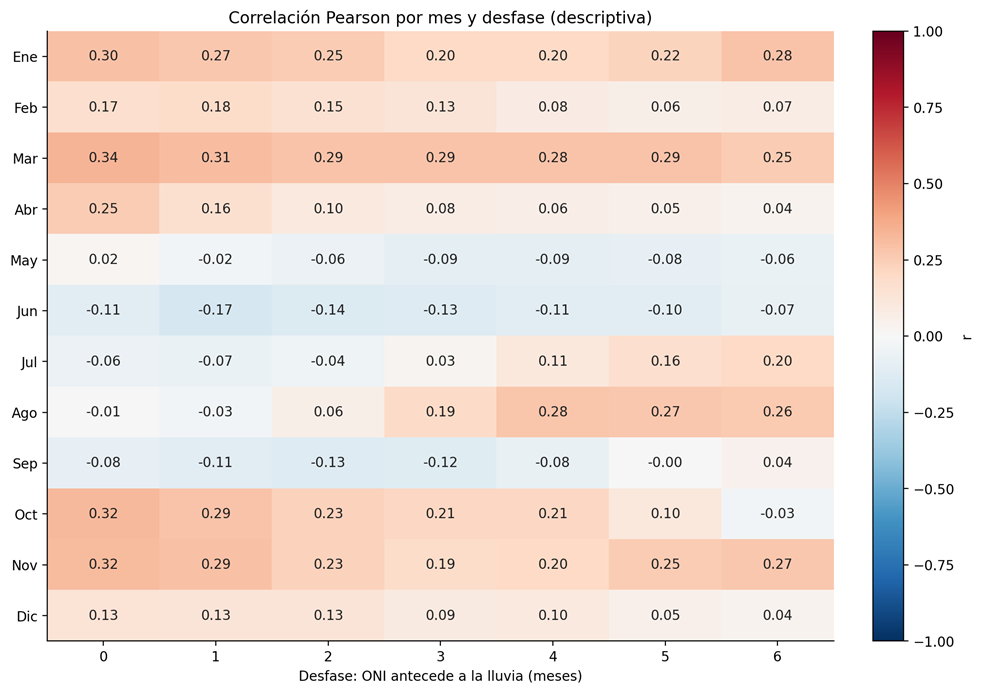

# Resultados: ONI, precipitación y desfases

La Figura 1 muestra la correlación de Pearson entre el ONI y la precipitación de cada mes. Las columnas indican cuántos meses antecede el ONI a la lluvia: `0` corresponde al mismo mes y `6` a seis meses antes.

## Valores observados

| Mes | 0 | 1 | 2 | 3 | 4 | 5 | 6 |
| --- | ---: | ---: | ---: | ---: | ---: | ---: | ---: |
| Ene | 0.30 | 0.27 | 0.25 | 0.20 | 0.20 | 0.22 | 0.28 |
| Feb | 0.17 | 0.18 | 0.15 | 0.13 | 0.08 | 0.06 | 0.07 |
| Mar | 0.34 | 0.31 | 0.29 | 0.29 | 0.28 | 0.29 | 0.25 |
| Abr | 0.25 | 0.16 | 0.10 | 0.08 | 0.06 | 0.05 | 0.04 |
| May | 0.02 | -0.02 | -0.06 | -0.09 | -0.09 | -0.08 | -0.06 |
| Jun | -0.11 | -0.17 | -0.14 | -0.13 | -0.11 | -0.10 | -0.07 |
| Jul | -0.06 | -0.07 | -0.04 | 0.03 | 0.11 | 0.16 | 0.20 |
| Ago | -0.01 | -0.03 | 0.06 | 0.19 | 0.28 | 0.27 | 0.26 |
| Sep | -0.08 | -0.11 | -0.13 | -0.12 | -0.08 | -0.00 | 0.04 |
| Oct | 0.32 | 0.29 | 0.23 | 0.21 | 0.21 | 0.10 | -0.03 |
| Nov | 0.32 | 0.29 | 0.23 | 0.19 | 0.20 | 0.25 | 0.27 |
| Dic | 0.13 | 0.13 | 0.13 | 0.09 | 0.10 | 0.05 | 0.04 |

## Lectura en lenguaje claro

Los tonos rojizos representan correlaciones positivas y los azules correlaciones negativas. Los valores cercanos a cero indican poca relación lineal.

En general, los valores son bajos. Las correlaciones positivas más altas se presentan en marzo (`r = 0.34`), octubre (`r = 0.32`) y noviembre (`r = 0.32`) sin desfase. En junio, la asociación negativa más marcada es `r = -0.17` cuando se compara la lluvia de junio con el ONI de mayo.

No se observa un desfase único que dé una relación alta y consistente para todos los meses. Por ejemplo, agosto alcanza `r = 0.28` con cuatro meses de desfase: el ONI de abril se compara con la lluvia de agosto. Esto describe una correspondencia estadística en la serie; no significa que el ONI de abril cause la lluvia de agosto.

## Conclusión

La relación entre ENSO y la precipitación parece cambiar a lo largo del año y, para esta serie, es limitada. Una correlación positiva o negativa no demuestra una causa directa de un mes lluvioso o seco.
