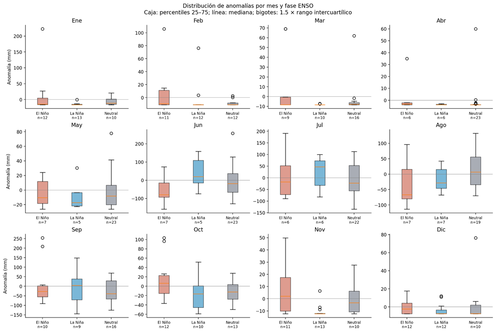

# Resultados: anomalías de lluvia por fase ENSO

La Figura 2 compara, mes por mes, las anomalías de precipitación durante años de El Niño, La Niña y condiciones neutrales. Los valores por encima de cero representan meses más lluviosos de lo normal; los valores por debajo de cero, meses más secos.

## Interpretación en lenguaje claro

No se observa el mismo comportamiento durante todo el año.

- En **junio**, los años de El Niño tienden a presentar menos lluvia de lo normal, mientras que durante La Niña aparecen valores más altos.
- En **julio**, La Niña también muestra una mediana positiva.
- En **octubre**, se aprecia un contraste: El Niño muestra en general anomalías más positivas que La Niña.

Sin embargo, estas diferencias no ocurren todos los años de la misma manera. En varios meses, los valores de El Niño, La Niña y neutral se mezclan entre sí; además, existen años extremos y algunos grupos tienen pocos casos.

## Conclusión

La figura sugiere que ENSO puede estar relacionado con la lluvia en algunos meses, pero no permite establecer reglas fijas como “El Niño siempre produce más o menos lluvia en Guadalajara”. Las diferencias deben interpretarse como descriptivas.
